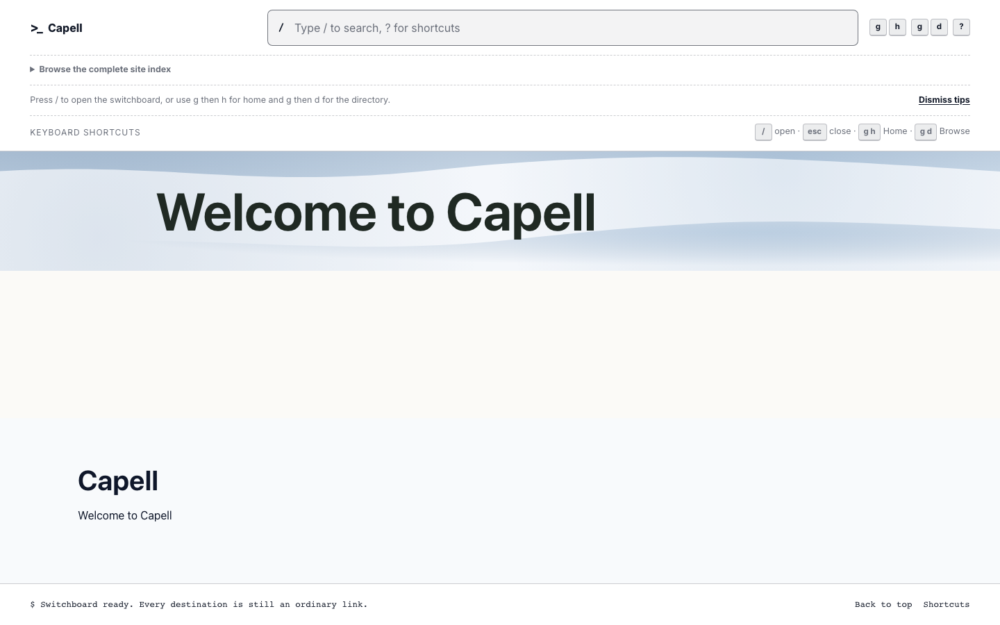

# Hero

<!-- prettier-ignore-start -->

## What It Does

Hero adds a Layout Builder hero widget with page copy, actions, responsive images or video, multiple slides, and inherited theme background options.

- **Price and availability:** Check current availability and price on the [Capell Marketplace listing](https://capell.app/extensions/hero).
- **Licence:** Check the licence terms on the [Capell Marketplace listing](https://capell.app/extensions/hero).
- **Requires:** `PHP ^8.4`, `capell-app/admin ^1.0`, `capell-app/core ^1.0.66`, `capell-app/frontend ^1.0`, `capell-app/layout-builder ^1.0`, `capell-app/theme-foundation ^1.0`, `lorisleiva/laravel-actions ^2.8`, `spatie/laravel-package-tools ^1.0`.
- **Install:** `composer require capell-app/hero`.

Editors configure the hero through Layout Builder and theme or widget background fields, while visitors receive the responsive hero rendered by the active theme.

## Who It Is For

**For developers:** Prepared Data objects and resolution Actions keep media and background decisions outside Blade, and tests enforce query-free public rendering without editor metadata.

**For teams:** Teams can establish reusable home-page defaults and still change copy, media, slides, and background treatment per widget without replacing unrelated page content.

## Quick Start

1. Install the package: `composer require capell-app/hero`.
2. Run the package setup: `php artisan capell:hero-setup`.
3. Run `php artisan list` and verify the package command signatures are registered.

## Configure

- **Commands:** `php artisan capell:hero-setup`.

## Limits And Pitfalls

- Install the required Capell packages at the versions in `composer.json`: `capell-app/admin ^1.0`, `capell-app/core ^1.0.66`, `capell-app/frontend ^1.0`, `capell-app/layout-builder ^1.0`, `capell-app/theme-foundation ^1.0`.
- Keep public Blade and cached HTML free of authoring markers, model IDs, permissions, signed editor URLs, and lazy database queries.
- Custom write integrations must preserve invalidation for `hero` cache tags.

## Screens And Workflow

- Hero home widget rendered on a public page (frontend).

## Install Impact

- Required packages: `capell-app/admin`, `capell-app/core`, `capell-app/frontend`, `capell-app/layout-builder`, `capell-app/theme-foundation`.
- Admin navigation: no admin page or resource contribution is declared.
- Admin/editor extensions: none declared.
- Permissions: no package permission declarations or Shield gates detected; host access rules still apply.
- Public routes: none declared.
- Database changes: no package migrations declared.
- Config: no package config files.
- Settings: no package settings declared.
- Queues or schedules: none declared.
- Cache tags: `hero`.
- Commands: `capell:hero-setup`.

## Troubleshooting

| Symptom | Likely cause | Check | Fix |
| --- | --- | --- | --- |
| Package surface is missing after install | Provider or manifest is not loaded | Confirm `capell.json`, package `composer.json`, and provider registration | Reinstall the package, refresh Composer autoload, and clear host caches |
| Public output leaks unexpected state | Render data, cache variation, or authoring boundary has regressed | Check public Blade, cache tags, and public-output safety tests | Move data loading out of Blade and rerun the package public-output tests |

## Upgrading

No manual steps between minor versions.

Read [CHANGELOG.md](CHANGELOG.md) before upgrading.

## Next Steps

- [Package docs](docs/README.md)
- [Overview](docs/overview.md)
- [Troubleshooting](#troubleshooting)
- [Developer reference](docs/reference.md)
- [Marketplace assets](docs/assets/marketplace/)
- [Capell content language plan](../../docs/CONTENT_LANGUAGE_PLAN.md)
- [Capell documentation design system](../../docs/DESIGN_SYSTEM.md)
- [Capell and package ERD notes](../../docs/erd/capell-and-package-erds.md)
- Related packages: [Layout Builder](../layout-builder/README.md), [Foundation Theme](../theme-foundation/README.md).

<!-- prettier-ignore-end -->
