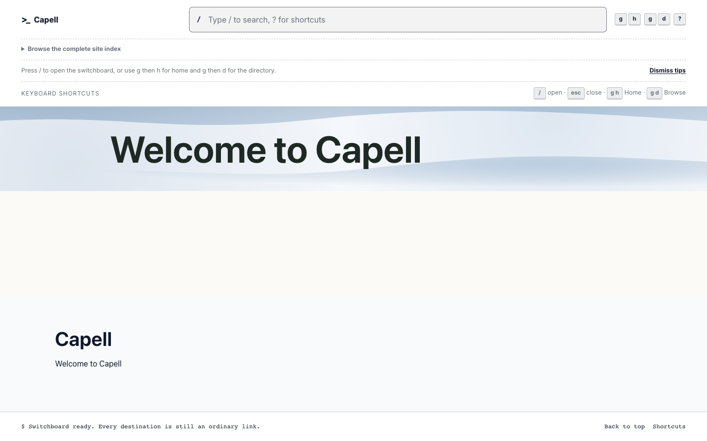

# Hero

<!-- prettier-ignore-start -->

## What This Plugin Adds

Hero is an **Available**, **No schema impact** Capell package in the **Capell Foundation** product group. It ships as `capell-app/hero` and extends these surfaces: admin, frontend, console.

Hero adds a Layout Builder hero widget with page copy, actions, responsive images or video, multiple slides, and inherited theme background options.

Editors configure the hero through Layout Builder and theme or widget background fields, while visitors receive the responsive hero rendered by the active theme.

Status details:

- Status: Available
- Tier: free
- Bundle: foundation
- Composer package: `capell-app/hero`
- Namespace: `Capell\Hero`
- Theme key: not applicable

## Why It Matters

**For developers:** Prepared Data objects and resolution Actions keep media and background decisions outside Blade, and tests enforce query-free public rendering without editor metadata.

**For teams:** Teams can establish reusable home-page defaults and still change copy, media, slides, and background treatment per widget without replacing unrelated page content.

## Screens And Workflow

Screenshot contract: `docs/screenshots.json`.

- Hero home widget rendered on a public page (frontend, required evidence).

## Technical Shape

### Service providers

- `Capell\Hero\Providers\HeroServiceProvider`

### Filament classes

- `HeroBackgroundSchema`
- `HeroBackgroundThemeSchemaExtender`
- `HeroBackgroundWidgetAssetSchemaExtender`
- `HeroBackgroundWidgetSchemaExtender`

### Actions

- `InstallHeroLayoutDefaultsAction`
- `ResolveHeroBackgroundDataAction`
- `ResolveHeroMediaDataAction`

### Data objects

- `HeroAssetSlideData`
- `HeroBackgroundData`
- `HeroMediaData`
- `HeroWidgetRenderData`

### Command signatures

- `capell:hero-setup`

### Console command classes

- `SetupCommand`

### Health checks

- `Capell\Hero\Health\HeroHealthCheck`

### Blade views

- `packages/hero/resources/views/components/hero/background.blade.php`
- `packages/hero/resources/views/components/hero/content.blade.php`
- `packages/hero/resources/views/components/hero/media.blade.php`
- `packages/hero/resources/views/components/hero/related.blade.php`
- `packages/hero/resources/views/components/hero/slide.blade.php`
- `packages/hero/resources/views/components/hero/wrapper.blade.php`
- `packages/hero/resources/views/components/widget/default.blade.php`
- `packages/hero/resources/views/components/widget/hero.blade.php`

### Cache tags

- `hero`

## Data Model

This package has no schema impact. It registers runtime behaviour through `Capell\Hero\Providers\HeroServiceProvider` while persistence remains with Capell core or required packages.

## Install Impact

- Required packages: `capell-app/admin`, `capell-app/core`, `capell-app/frontend`, `capell-app/layout-builder`.
- Admin navigation: no admin page or resource contribution is declared.
- Admin/editor extensions: none declared.
- Permissions: no package permission declarations or Shield gates detected; host access rules still apply.
- Public routes: none declared.
- Database changes: no package migrations declared.
- Config: no package config files.
- Settings: no package settings declared.
- Queues or schedules: none declared.
- Cache tags: `hero`.
- Commands: `capell:hero-setup`.

## Common Pitfalls

- Keep required Capell packages on compatible v4 releases: `capell-app/admin`, `capell-app/core`, `capell-app/frontend`, `capell-app/layout-builder`.
- Keep public Blade and cached HTML free of authoring markers, model IDs, permissions, signed editor URLs, and lazy database queries.
- Custom write integrations must preserve invalidation for `hero` cache tags.

## Troubleshooting

| Symptom | Likely cause | Check | Fix |
| --- | --- | --- | --- |
| Package surface is missing after install | Provider or manifest is not loaded | Confirm `capell.json`, package `composer.json`, and provider registration | Reinstall the package, refresh Composer autoload, and clear host caches |
| Public output leaks unexpected state | Render data, cache variation, or authoring boundary has regressed | Check public Blade, cache tags, and public-output safety tests | Move data loading out of Blade and rerun the package public-output tests |

## Quick Start

1. Install the package: `composer require capell-app/hero`.
2. Run the package setup: `php artisan capell:hero-setup`.
3. Open `/` and confirm the public output renders without admin state.

## Next Steps

- [Package docs](docs/README.md)
- [Overview](docs/overview.md)
- [Troubleshooting](#troubleshooting)
- [Screenshot contract](docs/screenshots.json)
- [Marketplace assets](docs/assets/marketplace/)
- [Capell content language plan](../../docs/CONTENT_LANGUAGE_PLAN.md)
- [Capell documentation design system](../../docs/DESIGN_SYSTEM.md)
- [Capell and package ERD notes](../../docs/erd/capell-and-package-erds.md)
- Related packages: [Layout Builder](../layout-builder/README.md).

<!-- prettier-ignore-end -->
